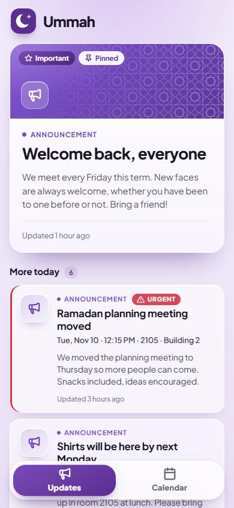
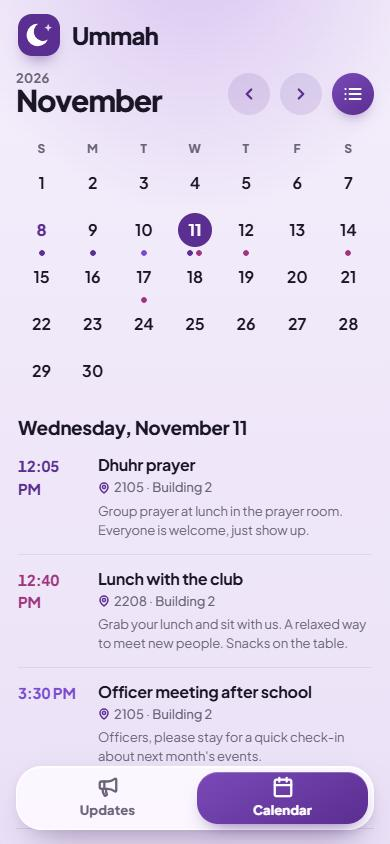

<div align="center">


# Ummah

**A simple, beautiful app for any Muslim Students Association: prayers, events and announcements in one place.**

A fast, phone-first web app. Install it to your home screen, get a push when something new is posted, and check the calendar in two taps.


</div>

<p align="center">
  
  &nbsp;&nbsp;
  
</p>

---

## Features

- **Updates feed**: a featured post up top, then everything else for the day. Announcements, prayers and socials each have their own look, with badges for *Important*, *Urgent* and *Pinned*.
- **Calendar**: a clean month view with a dot-and-chip summary per day, a list view, swipe between months, and a "Next up" hint on empty days.
- **Room numbers**: locations are shown as rooms, with the building worked out from the first digit (2105 is in Building 2).
- **Install and push**: works offline as a PWA, and sends a push notification when a post goes up or is cancelled.
- **Admin login**: officers sign in with a username and password, then post, edit, cancel or delete updates.
- **Feedback**: students can leave quick ratings and notes on events that ask for them.
- **Built for phones**: floating bottom navigation that tucks away while you scroll, large tap targets, light haptics, and gentle motion.

## Tech

| Piece | What it uses |
| --- | --- |
| Front end | Plain HTML, one CSS file, vanilla ES modules (no build step) |
| Data | [Supabase](https://supabase.com): Postgres, Row Level Security, Realtime |
| Push | [OneSignal](https://onesignal.com) via a Supabase Edge Function |
| Offline | Service worker with a versioned shell cache |
| Type | Plus Jakarta Sans |

## Project layout

```
index.html        Updates feed
calendar.html     Calendar (month and list views)
exec.html         Administrative login and posting
privacy.html      Privacy Policy
terms.html        Terms of Use
sw.js             Service worker (bump CACHE_NAME when assets change)
manifest.json     PWA manifest
assets/
  css/app.css     All styles and design tokens
  js/             reader, calendar, exec, shared helpers, icons, motion
  icons/          Logo and app icons
  img/            Geometric pattern art
supabase/
  migrations/     Database schema, policies, triggers
  functions/      notify-post edge function
  SAMPLE-POSTS.sql   Optional demo posts
  ADMIN-ACCOUNTS.md  How to create officer logins
design/           Design spec
```

## Make it yours

Ummah is built to be reused by any MSA. To brand it for your school or chapter:

- Change the name and colors: edit the `--brand` tokens at the top of `assets/css/app.css`, the strings in the HTML pages, and `manifest.json`.
- Swap the logo and icons in `assets/icons/`.
- Update the contact details and legal text in `privacy.html` and `terms.html`.
- Point `assets/js/config.js` at your own Supabase project.

## Run it locally

It is a static site, so any file server works:

```bash
python -m http.server 8080
```

Then open <http://localhost:8080>.

## Set up the backend

1. Create a Supabase project and put its URL and anon key in `assets/js/config.js`.
2. Apply the migrations in `supabase/migrations/` in order (SQL editor or `supabase db push`).
3. Create officer accounts by following [`supabase/ADMIN-ACCOUNTS.md`](supabase/ADMIN-ACCOUNTS.md). Officers sign in with a username, not an email.
4. *(Optional)* Add demo content by running [`supabase/SAMPLE-POSTS.sql`](supabase/SAMPLE-POSTS.sql) once. It turns push notifications off while it inserts so nobody gets pinged.
5. *(Optional)* Deploy the `notify-post` function and add your OneSignal keys to enable push.

## Changing assets

Every asset is loaded with a `?v=N` query string and listed in the service worker's precache. When you edit a CSS or JS file, bump its `?v=` in the HTML files and in `sw.js`, and bump `CACHE_NAME`, so phones pick up the new version.

## Design

Purple (`#5b2e91`) on a very light lilac page, frosted-glass surfaces, and Islamic geometric patterns used sparingly. The full spec lives in [`design/UMMAH-DESIGN-SPEC.md`](design/UMMAH-DESIGN-SPEC.md).

## Privacy

The app collects no personal data from readers. Feedback is anonymous. See the [Privacy Policy](privacy.html) and [Terms of Use](terms.html).

---

<div align="center">

Made by students, for our community.

&copy; 2026 Ummah

</div>
